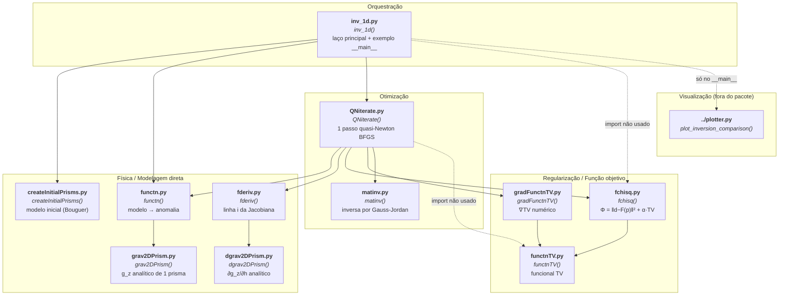
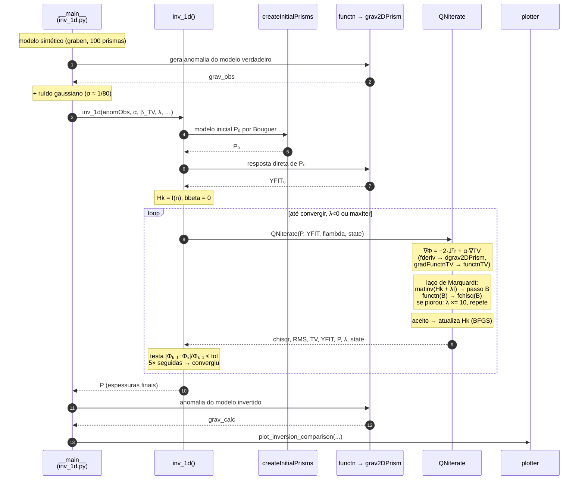

# Arquitetura do `tv1d` — Inversão Gravimétrica 1D com Variação Total

Mapa dos módulos Python em `python/tv1d/` e da cadeia de chamadas entre eles.
São 11 módulos de código (+ `__init__.py`), todos com uma única função pública
homônima ao arquivo — herança da tradução um-a-um do código MATLAB original em
`TVGRAV1D/`.

---

## 1. Grafo de dependências (quem importa quem)



> **Setas tracejadas** = importações herdadas da tradução do MATLAB que nunca são
> chamadas (`fchisq` em `inv_1d.py`, `functnTV` em `QNiterate.py`), ou
> dependências que só existem no bloco de exemplo `__main__`.

Todo módulo depende apenas de `numpy`; `plotter.py` depende também de
`matplotlib`. Não há dependência circular — o grafo é uma árvore de 4 níveis com
`functnTV.py`, `grav2DPrism.py`, `dgrav2DPrism.py` e `matinv.py` como folhas.

---

## 2. Fluxo de execução (ordem temporal das chamadas)



---

## 3. Papel de cada arquivo

| Arquivo | Função | Papel na inversão |
|---|---|---|
| `inv_1d.py` | `inv_1d()` | **Ponto de entrada.** Monta o modelo inicial, dispara o laço de iterações e aplica os critérios de parada (convergência, `maxIter`, falha de Marquardt). O bloco `__main__` traz um exemplo sintético completo (graben de 3 blocos) com semente fixa `np.random.seed(7)`. |
| `createInitialPrisms.py` | `createInitialPrisms()` | Chute inicial P₀ pela **aproximação da placa de Bouguer** (`h = Δg / 2πGρ`), com média ponderada por 1/d² das observações vizinhas e raio de busca crescente. |
| `functn.py` | `functn()` | **Modelagem direta.** Soma a contribuição de todos os prismas em cada estação: `F(p) → d_calc`. Suporta apenas `dcType=0` (contraste constante). |
| `grav2DPrism.py` | `grav2DPrism()` | Núcleo analítico: g_z de **um** prisma 2D de seção retangular (fórmula clássica com logaritmos e arco-tangentes). Folha do grafo. |
| `fderiv.py` | `fderiv()` | Monta a **linha `i` da matriz Jacobiana** — sensibilidade da estação `i` a cada espessura `P[k]`. |
| `dgrav2DPrism.py` | `dgrav2DPrism()` | Derivada **analítica** ∂g_z/∂h de um prisma. Folha do grafo. |
| `functnTV.py` | `functnTV()` | Funcional de **Variação Total** suavizado: `TV(p) = Σ √((pᵢ₊₁−pᵢ)² + β²)`. É o que preserva descontinuidades (falhas) no modelo. Folha do grafo. |
| `gradFunctnTV.py` | `gradFunctnTV()` | **Gradiente numérico** de `functnTV` por diferenças centradas (passo de 1% ou 0.001, o que for maior). |
| `fchisq.py` | `fchisq()` | **Função objetivo** Φ = ‖d_obs − d_calc‖² + α·TV(p). Devolve também o RMS normalizado e o valor de TV isolado, usados no log de cada iteração. |
| `QNiterate.py` | `QNiterate()` | **Coração do otimizador.** Uma iteração quasi-Newton BFGS com amortecimento de Marquardt: calcula o gradiente, resolve o sistema amortecido, testa o passo, aumenta λ enquanto o objetivo piorar e atualiza a Hessiana aproximada. Os `persistent` do MATLAB (`Hk`, `bbeta`) viram o dicionário `state`. |
| `matinv.py` | `matinv()` | Inversão de matriz por **Gauss-Jordan com pivotamento total**, tradução fiel do MATLAB. Folha do grafo. Equivale a `np.linalg.inv`. |
| `../plotter.py` | `plot_inversion_comparison()` | Figura de dois painéis: anomalia observada × calculada (topo) e modelo verdadeiro × invertido em degraus (base). Só é usado pelo exemplo `__main__`. |
| `__init__.py` | — | Marca o diretório como pacote; sem código. |

---

## 4. Duplo esquema de importação

Todos os módulos com dependências internas usam o padrão:

```python
try:
    from .functnTV import functnTV     # executado como pacote: python -m tv1d.inv_1d
except ImportError:
    from functnTV import functnTV      # executado como script solto: python inv_1d.py
```

Isso permite rodar tanto `python tv1d/inv_1d.py` quanto importar `tv1d` como
pacote. O bloco `__main__` de `inv_1d.py` ainda insere o diretório `python/` no
`sys.path` para alcançar `plotter.py`, que vive um nível acima do pacote.

---

## 5. Correspondência com o MATLAB original

Cada arquivo `.py` em `python/tv1d/` é a tradução direta do `.m` homônimo em
`TVGRAV1D/`. As diferenças estruturais:

| MATLAB | Python | Observação |
|---|---|---|
| `exemplo1.m` | bloco `__main__` de `inv_1d.py` | o exemplo virou parte do próprio módulo |
| `inv_1D.m` | `inv_1d.py` | leitura de `input.nl` substituída por argumentos nomeados |
| `persistent Hk, bbeta` | dicionário `state` | estado explícito passado ida-e-volta |
| `plotarmodelo2D.m` | `../plotter.py` | movido para fora do pacote, compartilhado |
| `hypGrav2DPrism.m`, `dhypGrav2DPrism.m` | — | `dcType=1` (contraste hiperbólico) **não foi portado**; levanta `NotImplementedError` |
| `noise.m` | `np.random.randn` | inline em `inv_1d` (parâmetro `noise_sigma`) |
